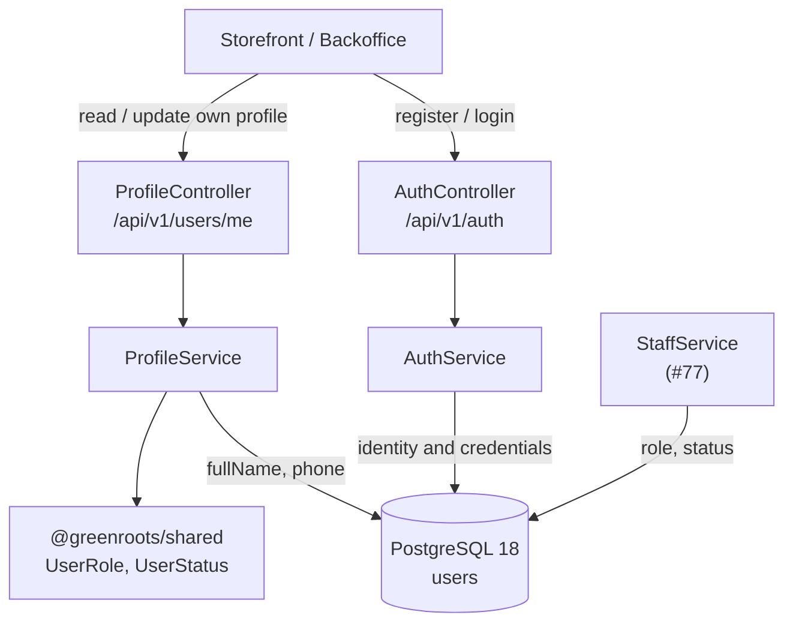
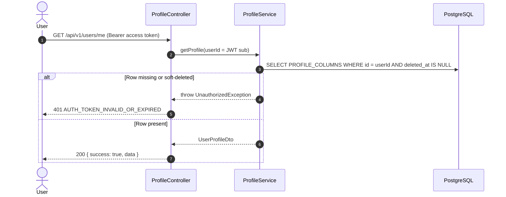
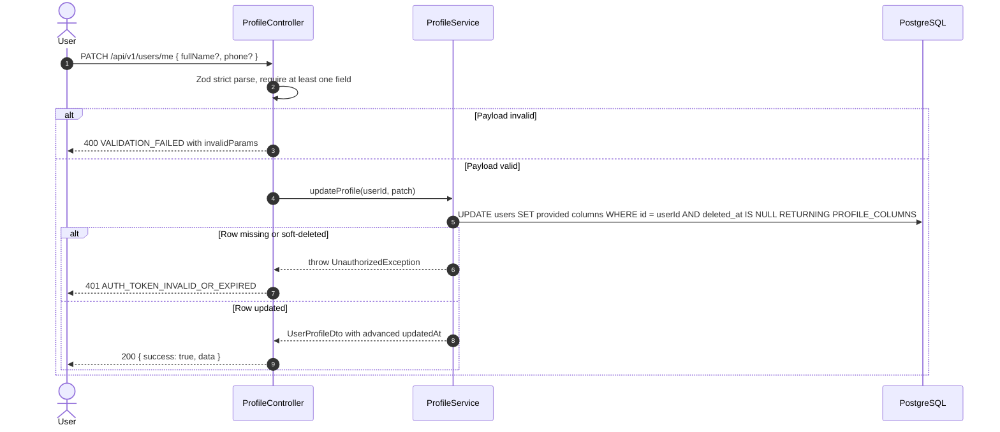

# Self-Service Profile Formal Specification

## Overview & Context

This document specifies the self-service profile surface introduced by #75 (split from #18) and the write-ownership rule recorded in ADR-0020.

Today every read and write of `users` happens inside `AuthService`. A signed-in customer or staff member cannot read their own profile through the API, and no surface exists for the two self-editable fields, `fullName` and `phone`. The sibling specs for the address book (#76) and staff management (#77) already assume that `apps/api/src/modules/users` hosts the user-facing surfaces, so this issue creates that module boundary.

The contract also carries a naming defect. `registerSchema` accepts `phoneNumber` while the `users` column, the response metadata, and every other surface use `phone`. Because no client calls the register endpoint yet, this issue renames the input in the same PR instead of leaving two names for one concept.

### Goals

- Expose `GET /api/v1/users/me` and `PATCH /api/v1/users/me` for the authenticated subject only.
- Return a closed projection that cannot expose credentials, verification tokens, reset tokens, or soft-delete state.
- Make `fullName` and `phone` the only writable fields, with `email`, `role`, `status`, `rewardPoints`, `emailVerified`, and timestamps read-only.
- Rename the register input `phoneNumber` to `phone` so every surface uses the schema term.
- Keep the profile shape in one place instead of adding a third ad-hoc user type.

### Non-Goals

- Email change, re-verification, password change, or account deletion.
- Avatar or profile media upload.
- Admin editing another user's profile; #77 owns that surface.
- Loyalty-point mutation; `rewardPoints` is read-only here.
- Optimistic concurrency or ETag-style version checks.
- Per-request account-status enforcement; see the status policy below.

## Architecture

Symbols and their locations:

- `ProfileController` in `apps/api/src/modules/users/profile.controller.ts` exposes `GET` and `PATCH` on `USERS_ROUTES.ME`.
- `ProfileService` in `apps/api/src/modules/users/profile.service.ts` owns `PROFILE_COLUMNS`, the read, the single-statement update, and the not-found mapping.
- `USERS_ROUTES` in `apps/api/src/modules/users/users.routes.ts` holds the tag and path constants.
- `UpdateProfileDto` and `UserProfileDto` in `apps/api/src/modules/users/dto/` are Zod-backed transport schemas per ADR-0011.
- `PROFILE_COLUMNS` is a runtime Drizzle projection, so it lives in the service, not in a pure interface file.
- `UserInfoDto` in `apps/api/src/modules/auth/dto/login-response.dto.ts` remains the identity summary returned by authentication. It is not a profile.
- The unused `AuthUser` interface in `apps/api/src/modules/auth/auth.interface.ts` is deleted; it duplicates the profile shape without owning the projection.

Write ownership follows ADR-0020: authentication keeps `email`, `password`, and the verification and reset columns; `ProfileService` writes only `fullName` and `phone`; `StaffService` will write only `role` and `status`.

## Operational Flow

### 1. Read the profile

### 2. Update the profile

The update is one statement with `RETURNING`. There is no read-modify-write cycle, so two concurrent requests cannot overwrite columns that the other request did not supply.

### 3. Registered contact field

`POST /api/v1/auth/register` accepts `phone` instead of `phoneNumber`. `AuthService.register` already writes the value into the `phone` column, so only the DTO, its tests, and the generated contracts change. `fullName` keeps its existing 1–100 validation; the `varchar(255)` column is headroom, not a product limit.

## API Contract

`UserProfileDto` projection, in this order:

| Field           | Type             | Source                | Writable |
| :-------------- | :--------------- | :-------------------- | :------- |
| `id`            | UUIDv7 string    | `users.id`            | No       |
| `email`         | string           | `users.email`         | No       |
| `fullName`      | string, 1–100    | `users.fullName`      | Yes      |
| `phone`         | string or `null` | `users.phone`         | Yes      |
| `role`          | `UserRole`       | `users.role`          | No       |
| `status`        | `UserStatus`     | `users.status`        | No       |
| `rewardPoints`  | integer, `>= 0`  | `users.rewardPoints`  | No       |
| `emailVerified` | boolean          | `users.emailVerified` | No       |
| `createdAt`     | ISO-8601 string  | `users.createdAt`     | No       |
| `updatedAt`     | ISO-8601 string  | `users.updatedAt`     | No       |

`UpdateProfileDto` accepts exactly two optional keys and rejects everything else:

- `fullName`: sanitized, trimmed, whitespace collapsed, 1–100 characters.
- `phone`: a 10-digit Vietnamese mobile number matching `0[35789]\d{8}`, or `null` to clear it.
- An empty object is rejected. An empty string for `phone` is rejected; only `null` clears the field.

Responses:

| Surface               | Success                     | Errors                                                                          |
| :-------------------- | :-------------------------- | :------------------------------------------------------------------------------ |
| `GET /users/me`       | `200` with `UserProfileDto` | `401 AUTH_TOKEN_INVALID_OR_EXPIRED` when the subject is missing or soft-deleted |
| `PATCH /users/me`     | `200` with `UserProfileDto` | `400 VALIDATION_FAILED`, `401 AUTH_TOKEN_INVALID_OR_EXPIRED`                    |
| `POST /auth/register` | `201` unchanged             | `400 VALIDATION_FAILED` now names `phone`; `phoneNumber` is an unrecognized key |

No new entries are added to `API_ERROR_CODES`: the profile surface reuses `VALIDATION_FAILED`, the per-field validation codes, and the existing 401 code.

## Security & Reliability

- **Authorization**: any authenticated role may call the surface, and it always acts on the JWT `sub`. There is no `:id` parameter, no query parameter, and no body field that selects a user. A request that carries `id`, `email`, `role`, `status`, `rewardPoints`, or `emailVerified` is rejected with `400 UNRECOGNIZED_KEYS`.
- **Projection closure**: `PROFILE_COLUMNS` is a closed list. The service never returns a row or spreads an entity, so `password`, `verificationToken`, `verificationExpiresAt`, `resetPasswordToken`, `resetPasswordExpiresAt`, and `deletedAt` cannot reach the response.
- **Soft delete**: every read and write carries `deletedAt IS NULL`. A token whose subject no longer resolves to a live row receives `401 AUTH_TOKEN_INVALID_OR_EXPIRED`, the same code clients already treat as "sign in again". No new error code is introduced for a path that no API surface can create today.
- **Account status**: the surface does not re-check `status` per request. Suspension is enforced where sessions are issued: `login` returns `403 AUTH_ACCOUNT_SUSPENDED`, `refreshToken` returns `401 AUTH_ACCOUNT_SUSPENDED`, and #77 revokes refresh sessions and blacklists the user on suspension. The residual access-token window is therefore at most one 15-minute TTL, and the only write available inside that window is the user's own contact fields.
- **PII handling**: `phone` and `fullName` are personal data. They are never logged by the service; error responses echo field paths and validation reasons, not values. The projection returns the caller's own data only.
- **Input safety**: `fullName` passes through `zSanitizedString`, which strips HTML and collapses whitespace; `phone` is a fixed-shape regex. Unknown keys fail before the service is reached.
- **Rate limiting**: both routes use the default authenticated bucket (100 requests per minute). No dedicated tier is warranted for a self-service read and a two-field write.
- **Concurrency**: the write is a single `UPDATE ... RETURNING`. Two concurrent PATCHes converge to the later commit per column; there is no cross-field lost update and no partial update. Optimistic locking is explicitly out of scope.
- **Failure behaviour**: a database error surfaces through the global exception filter as `500 INTERNAL_SERVER_ERROR`; the service adds no retry and no cache, so a failed update leaves the previous state intact.
- **Contract propagation**: `bun run types:sync` regenerates `apps/api/openapi.json`, the storefront and backoffice schema types, and the API test fixture. Both new routes and the register field rename appear in that diff.

## Domain Invariant Taxonomy

| Invariant       | Name                 | Formal statement                                                                                              | Enforcement seam                                        | Verification test                                                        |
| :-------------- | :------------------- | :------------------------------------------------------------------------------------------------------------ | :------------------------------------------------------ | :----------------------------------------------------------------------- |
| `INV-PROFILE-1` | Projection closure   | The response contains exactly `PROFILE_COLUMNS` plus the response envelope                                    | `PROFILE_COLUMNS` closed select in `ProfileService`     | Response keys equal the contract list; no credential keys present        |
| `INV-PROFILE-2` | Self-only identity   | The target user equals the JWT `sub` for every read and write                                                 | Route has no id parameter; service takes `sub` only     | Token for user A never reads or writes user B                            |
| `INV-PROFILE-3` | Read-only identity   | No request can change `email`, `role`, `status`, `rewardPoints`, `emailVerified`, `createdAt`, or `updatedAt` | Strict DTO with two keys; unknown keys fail at the pipe | Sending each protected field returns `400 UNRECOGNIZED_KEYS`             |
| `INV-PROFILE-4` | Writable set         | Every persisted mutation is a subset of `{fullName, phone}`                                                   | `UpdateProfileDto` plus the service's patch builder     | Database row differs only in the supplied fields                         |
| `INV-PROFILE-5` | Non-empty command    | A PATCH with no writable field is rejected, never treated as a no-op                                          | Schema refinement requiring at least one key            | Empty body returns `400 VALIDATION_FAILED`                               |
| `INV-PROFILE-6` | Phone disambiguation | Absent keeps the value, `null` clears it, and an empty string is invalid                                      | `zPhoneNumber().nullable()` plus partial object         | Three cases produce unchanged, `null`, and `400` respectively            |
| `INV-PROFILE-7` | Normalized name      | The stored `fullName` is sanitized, trimmed, whitespace-collapsed, and 1–100 characters                       | `zSanitizedString({ min: 1, max: 100 })`                | HTML input is stripped; 101 characters return `400 TOO_BIG`              |
| `INV-PROFILE-8` | Live subject         | Every read and write filters `deletedAt IS NULL`, and a missing subject yields `401`                          | `and(eq(users.id, sub), isNull(users.deletedAt))`       | Soft-deleted user with a valid token receives `401`                      |
| `INV-PROFILE-9` | Last-write-wins      | Concurrent PATCHes converge per column to the later commit; no unset column is overwritten                    | Single `UPDATE` built from the parsed patch             | Two concurrent PATCHes leave both supplied columns at their final values |

### Edge cases

| Case                                | Expected behaviour                                           |
| :---------------------------------- | :----------------------------------------------------------- |
| `{}`                                | `400 VALIDATION_FAILED`, refinement reason, no database call |
| `{ "fullName": "" }`                | `400` with `REQUIRED` on `fullName`                          |
| `{ "fullName": "   " }`             | `400` after sanitize and trim                                |
| `{ "fullName": "<b>An</b>" }`       | Stored as `An`                                               |
| `{ "fullName": <101 characters> }`  | `400` with `TOO_BIG` on `fullName`                           |
| `{ "phone": "0912345678" }`         | Stored as `0912345678`                                       |
| `{ "phone": null }`                 | Column set to `NULL`                                         |
| `{ "phone": "" }`                   | `400` with `INVALID_VALUE` on `phone`                        |
| `{ "phone": "+84912345678" }`       | `400` with `INVALID_VALUE` on `phone`                        |
| `{ "email": "x@y.z" }`              | `400` with `UNRECOGNIZED_KEYS` on `email`                    |
| `{ "rewardPoints": 999 }`           | `400` with `UNRECOGNIZED_KEYS` on `rewardPoints`             |
| Missing bearer token                | `401` from `JwtAuthGuard`                                    |
| Valid token for a soft-deleted user | `401 AUTH_TOKEN_INVALID_OR_EXPIRED`                          |
| Valid token for a suspended user    | `200`; the session is revoked at the next refresh or by #77  |

## Test Matrix

Integration tests in `apps/api/test/integration/users.spec.ts`, using the existing `createAuthenticatedUser()` helper:

- `GET` success returns exactly the contract keys and the caller's values.
- `GET` without a token returns `401`.
- `GET` for a soft-deleted subject returns `401`.
- `GET` for a suspended subject returns `200` while the access token is valid.
- `PATCH` updates `fullName`, `phone`, and both fields; the response reflects sanitized values and an advanced `updatedAt`.
- `PATCH` with `phone: null` clears the column.
- `PATCH` rejects an empty body, an empty `phone`, an invalid `phone`, an over-length `fullName`, and each protected field.
- `PATCH` with a token for user A never touches user B, verified by reading both rows after the request.
- Two users update concurrently; each row keeps its own values.
- Register accepts `phone` and rejects `phoneNumber` with `UNRECOGNIZED_KEYS`; the auth integration suite is updated accordingly.
- `bun run types:sync` is run and the generated contract diff contains only the two new routes and the register field rename.

## Risks & Rollback

- **Register rename**: this is a breaking contract change, but `phoneNumber` appears only in the register DTO, the API tests, and generated type files. No storefront or backoffice client calls the endpoint. Updating the three generated files in the same PR keeps the contract consistent.
- **Two shapes**: `UserProfileDto` and `UserInfoDto` overlap on five fields by design. `UserInfoDto` is an authentication summary; extending it with `phone`, `rewardPoints`, or timestamps would blur the boundary and is out of scope.
- **No optimistic concurrency**: two devices editing the same profile resolve to last-write-wins. Accepted for two low-risk fields; a version column would add schema weight no current feature needs.
- **Status window**: a suspended user can still edit their own contact fields for up to 15 minutes. This follows ADR-0016 and closes completely once #77 revokes sessions on suspension.
- **Rollback**: revert the PR and re-run `bun run types:sync`. No migration, no data backfill, and no background job are involved.
